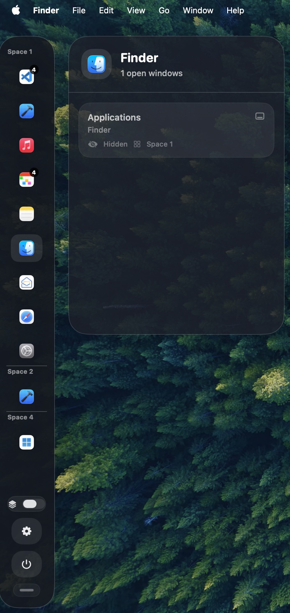

# WindowBar

WindowBar is a macOS SwiftUI utility that shows a floating edge sidebar with the currently open apps and their windows. It is designed to make it faster to switch between windows, jump across Spaces, and send files to running apps.



## What It Does

- Reveals a floating sidebar when you hover at the screen edge
- Lists running apps and their open windows
- Groups window entries by macOS Space
- Focuses a selected window and switches to its Space when needed
- Lets you hide or quit apps directly from the sidebar
- Supports dropping files onto app icons to open them in that app
- Includes settings for:
  - showing only the current Space
  - placing the sidebar on the right edge
  - remembering rail scroll position

## Requirements

- macOS
- Xcode 26 or newer
- Accessibility permission enabled for the app

WindowBar uses macOS accessibility APIs to inspect and focus windows. On first launch, you will likely need to grant permission in:

`System Settings > Privacy & Security > Accessibility`

## Project Structure

```text
WindowBar/
├── WindowBar.xcodeproj
├── WindowBar/
│   ├── AppDelegate.swift
│   ├── ContentView.swift
│   ├── WindowBarApp.swift
│   ├── WindowInventory.swift
│   └── Assets.xcassets
├── WindowBarTests/
└── WindowBarUITests/
```

## Build And Run

1. Open `WindowBar.xcodeproj` in Xcode.
2. Select the `WindowBar` scheme.
3. Build and run the app.
4. Grant Accessibility access when prompted or from System Settings.

## Notes

- The app is implemented with SwiftUI and AppKit.
- Window inventory and focus behavior rely on macOS windowing and accessibility APIs.
- The included test targets are mostly placeholders at the moment.
